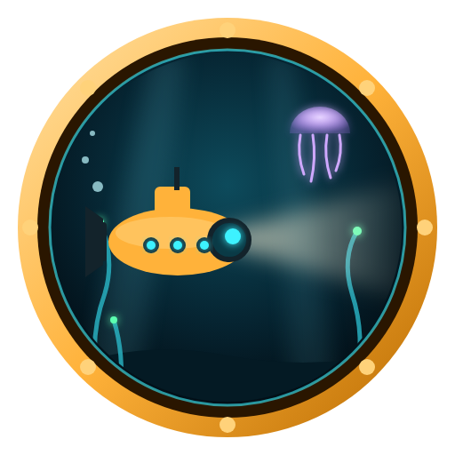
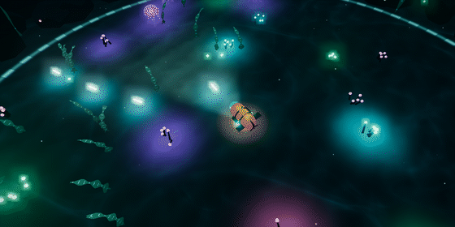
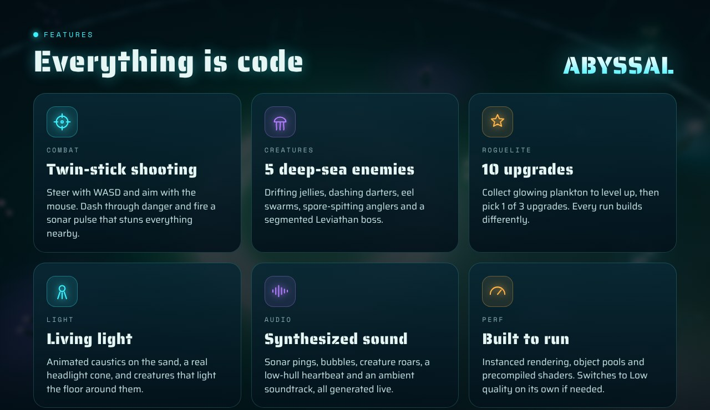
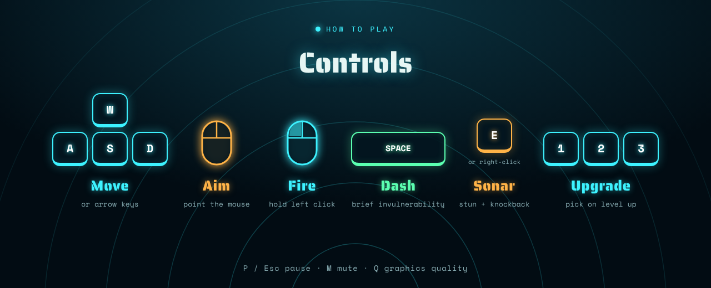
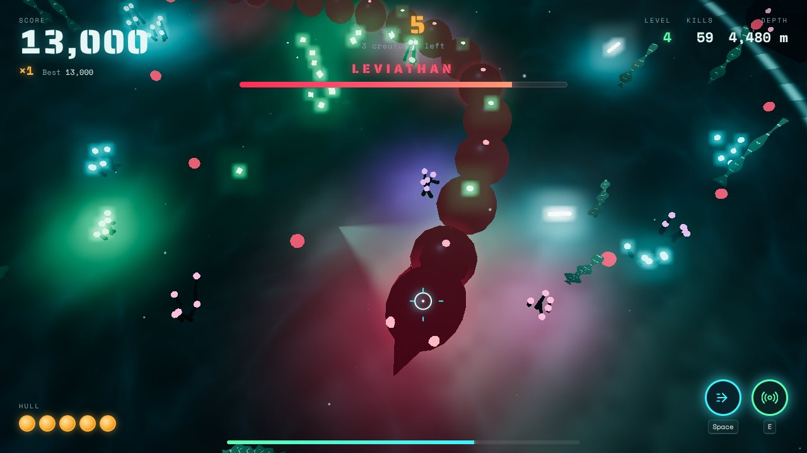
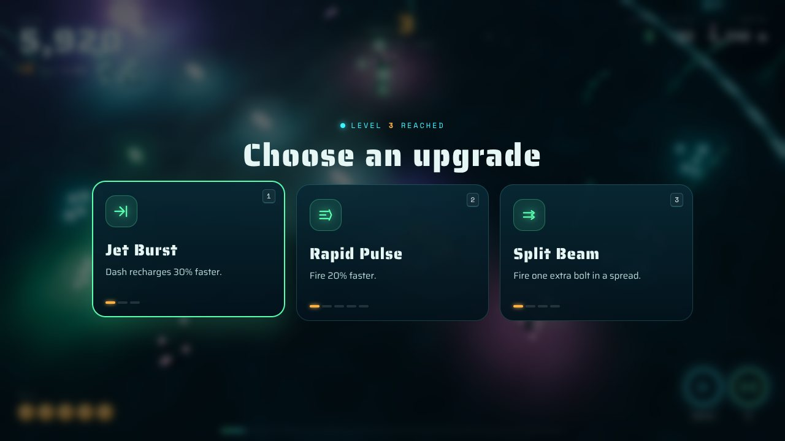
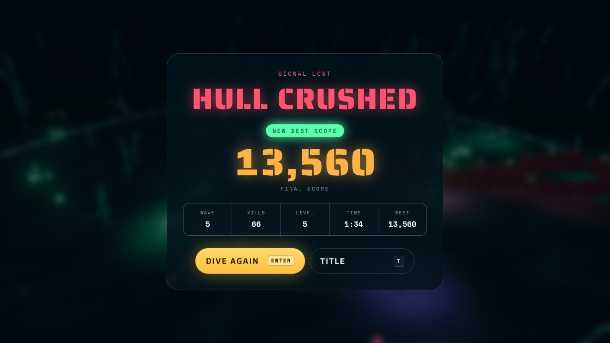

<p align="center">
  
</p>

<h1 align="center">ABYSSAL</h1>

<p align="center">
  <b>A bioluminescent deep-sea arena shooter with roguelite upgrades.</b><br>
  Pilot a tiny bathysphere 4,000 m down, hold back waves of glowing creatures, and outlast the Leviathan.
</p>

<p align="center">
  
  
  
  
</p>

<p align="center">
  
</p>

Built with **Three.js + Vite**. Every model, texture, shader, sound and the soundtrack is generated in code, so there are no downloaded assets.





| Combat | Level up | Game over |
|---|---|---|
|  |  |  |

## Quick start

Requires [Node.js](https://nodejs.org) 18 or newer.

```bash
npm install
npm run dev
```

The game opens at `http://localhost:5173`. Press **Enter** (or click **Dive**) to start.

```bash
npm run build     # production build in dist/
npm run preview   # serve the production build locally
```

## Controls

| Input | Action |
|---|---|
| `W` `A` `S` `D` / arrow keys | Move |
| Mouse | Aim |
| Left click (hold) | Fire light bolts |
| `Space` / `Shift` | Dash (brief invulnerability) |
| `E` / right click | Sonar pulse: stuns and knocks back nearby creatures, destroys spores |
| `1` `2` `3` / click | Choose an upgrade on level up |
| `P` / `Esc` | Pause / resume |
| `R` · `T` | Restart · back to title (from pause or game over) |
| `M` · `Q` · `F` | Mute · graphics quality · FPS counter |

## How to play

- **Survive the waves.** Creatures arrive from the edge of the trench, with a red ring on the sand warning you where each will appear.
- **Collect plankton** (green crystals) dropped by creatures to fill the XP bar. When a wave ends, all remaining plankton is pulled to you automatically.
- **Level up** and choose 1 of 3 upgrades: faster fire, more damage, split shots, piercing bolts, extra hull, speed, a bigger plankton magnet, sonar and dash cooldowns.
- **Chain kills** to raise the score multiplier (up to ×8). Getting hit resets it.
- **Every 5th wave** the **Leviathan** surfaces, a segmented sea serpent that circles you, charges, and sprays rings of spores. Its whole body can be hit.
- Rare **amber repair kits** restore one hull point.
- Your best score and deepest wave are saved in the browser.

### The creatures

| Creature | Behaviour |
|---|---|
| **Jellyfish** | Slow and pulsing; drifts toward you in bursts |
| **Darter** | Circles you, then flashes and dashes along a telegraphed line |
| **Eel swarm** | Six fast, wriggling eels that arrive together |
| **Anglerfish** | Tanky; keeps its distance and spits spores (triple spores from wave 9) |
| **Leviathan** | Boss every 5 waves: orbit, charge and spore-ring attacks, tougher each time |

## Features

**Visuals**
- Sand floor shader with animated caustics, sand ripples, a headlight cone that follows your aim, and colored light pools cast by creatures, bolts and coral (up to 14 lights in one pass)
- Instanced kelp that sways in a vertex shader, glowing coral, rock ring, god rays and drifting marine snow
- Procedural sub with a working spotlight, spinning propeller, banking and bubble trail
- Bloom, ACES tone mapping, depth fog, screen shake, hit flashes, slow motion on death
- Sci-fi UI: stencil type, cooldown rings, XP bar, boss health bar, animated upgrade cards

**Gameplay**
- Twin-stick combat with dash and sonar abilities
- 5 enemy types with distinct AI, telegraphed spawns and a multi-phase boss
- Endless waves with budget-based composition that scales with the wave number
- 10 upgrades with level caps, combo multiplier, repair kits, saved best score
- States: title → playing → level up → paused → dying → game over → restart

**Audio** (Web Audio API, all synthesized): ambient drone, sub engine hum, sonar ping with echo, shots, hits, creature deaths, Leviathan roar, low-hull heartbeat, and a minor-key ambient track whose intensity rises with the waves.

**Performance**
- Instanced rendering for bolts, spores, plankton, kelp, coral and rocks; pooled creatures and particles
- Shaders compile at startup so the first enemy of each type doesn't hitch
- Auto quality: drops to Low (no bloom, lower resolution) if the frame rate stays under 40 fps. `Q` toggles manually, and your choice is saved.
- Clear message if WebGL 2 is unavailable

## Project structure

```
abyssal/
├── index.html               # HUD, menus, upgrade cards
├── src/
│   ├── main.js              # entry point
│   ├── style.css            # UI styles
│   └── game/
│       ├── Game.js          # renderer, state machine, waves, combat, camera, loop
│       ├── World.js         # floor shader, kelp, coral, rocks, god rays, marine snow
│       ├── Player.js        # procedural sub, spotlight, dash and sonar
│       ├── Enemies.js       # creature prefabs, AI, spawn telegraphs, Leviathan boss
│       ├── Projectiles.js   # instanced bolts and spores
│       ├── Pickups.js       # plankton XP and repair kits
│       ├── Upgrades.js      # roguelite upgrade catalogue
│       ├── Effects.js       # pooled particle system
│       ├── AudioEngine.js   # synthesized audio and music
│       ├── Input.js         # keyboard and mouse
│       ├── UI.js            # DOM overlay
│       └── config.js        # tuning constants and helpers
├── docs/                    # images for this README
└── .github/workflows/deploy.yml
```

Tuning values (player stats, arena size, fog, wave break) are in `src/game/config.js`. Enemy stats are in `TYPES` in `src/game/Enemies.js`.

## Deploy to GitHub Pages

The included workflow builds and publishes the game on every push to `main`.

1. Push the project to a GitHub repository.
2. In the repo, open **Settings → Pages** and set **Source** to **GitHub Actions**. Do this before your first push, or re-run the workflow afterwards.
3. The game goes live at `https://<your-username>.github.io/<repo-name>/`.

`vite.config.js` uses `base: './'`, so it works under any repository name.

**Social preview:** go to **Settings → General → Social preview** and upload `docs/social-preview.jpg` (1280×640) so shared links show the banner.

## Notes

- Built for desktop with keyboard and mouse.
- Needs a browser with WebGL 2: any recent Chrome, Edge or Firefox.

## License

[MIT](LICENSE)
